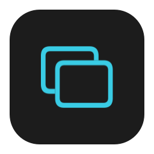
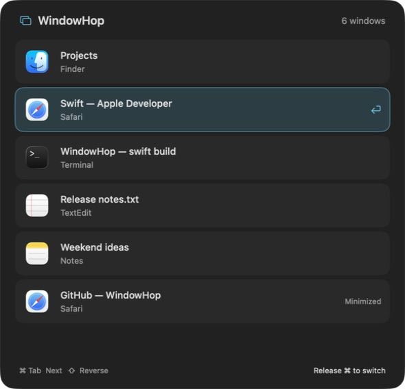
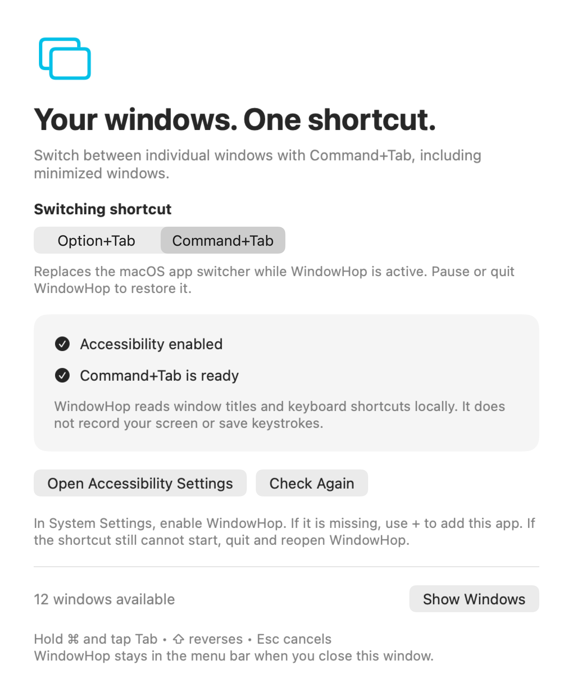

<p align="center">
  
</p>

<h1 align="center">WindowHop</h1>
<p align="center"><strong>Windows-style window switching, built for macOS.</strong></p>
<p align="center">One shortcut. Every window. Even the minimized ones.</p>

<p align="center">
  
  
  <a href="https://github.com/hpkruger/WindowHop/actions/workflows/build.yml"></a>
</p>

<p align="center">
  <a href="docs/images/switcher.png"></a>
</p>
<p align="center"><sub>The native picker at 3× resolution, with example window titles. Click to view full size.</sub></p>

## Switch to the window you meant

macOS Command+Tab selects an app. If that app has several windows, finding the one you want takes another step. And activating an app can leave its minimized window tucked away.

WindowHop puts individual windows in a single picker. Two Safari windows get two entries. A minimized document stays within reach. Hold your chosen modifier, tap Tab, and release to bring the selected window forward.

## What it does

- **Switch between windows across apps.** See each window's title and app icon in a horizontal Alt-Tab-style picker.
- **Preview windows at a glance.** Live thumbnails are enabled by default and can be turned off in Settings for a compact picker.
- **Choose Option+Tab or Command+Tab.** Change the shortcut in Settings; your choice survives restarts.
- **Restore minimized windows.** Selecting a window unhides its app and restores the window before raising it.
- **Return to recent windows.** Rapid taps alternate between your last two windows. Focus events update history independently of window discovery, and the order stays steady while you cycle.
- **Choose which Spaces to include.** Current Space is the default; choose All Spaces in Settings to include windows on other desktops. Minimized, hidden, and unidentifiable windows remain available in either mode.
- **Go either direction.** Add Shift to reverse, use arrow keys to navigate, or click a window.
- **Stay out of the way.** A menu-bar utility with a picker that does not take keyboard focus from your work.

## Build and install

You need **macOS 13 or later** and a Swift 5.9-or-later toolchain with the macOS SDK. The app uses AppKit and SwiftUI, with no third-party package dependencies.

```sh
git clone https://github.com/hpkruger/WindowHop.git
cd WindowHop
./scripts/build.sh

mkdir -p ~/Applications
ditto --norsrc --noextattr build/WindowHop.app ~/Applications/WindowHop.app
open ~/Applications/WindowHop.app
```

This builds a local app. Signing uses `WINDOWHOP_SIGN_IDENTITY` when set, otherwise the certificate fingerprint saved in `~/Library/Application Support/WindowHop/signing-identity`. Without either, it uses ad-hoc signing. There is currently no notarized installer.

### First launch

1. Click **Open Accessibility Settings** in WindowHop.
2. Enable **WindowHop**. If it is missing, use **+** to add the installed app.
3. Choose **Option+Tab** or **Command+Tab** under **Switching shortcut**.
4. Hold the modifier, tap Tab, and release to switch.

WindowHop checks for permission changes automatically. Use **Check Again** or restart the app if necessary.

**Command+Tab mode replaces the standard macOS app switcher while WindowHop is active.** Pause or quit WindowHop from its menu-bar menu to return to the system switcher. Option+Tab is the default and leaves the system's Command+Tab shortcut available.

<p align="center">
  <a href="docs/images/settings.png"></a>
</p>
<p align="center"><sub>Settings at 3× resolution. Choose your shortcut and check Accessibility access. Click to view full size.</sub></p>

## Keyboard controls

“Modifier” means **Option** or **Command**, according to your setting.

| Action | Shortcut |
| --- | --- |
| Select the previous window | Hold modifier and tap **Tab** |
| Cycle forward | Keep holding modifier and tap **Tab** again |
| Cycle backward | Modifier + **Shift + Tab** |
| Activate the selection | Release the modifier |
| Activate immediately | **Return**, or click a window |
| Move through the list | **Arrow keys** while the picker is open |
| Cancel | **Escape** |

The picker opens on the display containing your pointer. You can also open it with **Show Windows** in Settings or the menu-bar menu. Typing another key, clicking outside, or switching apps dismisses it.

## Permissions and privacy

WindowHop needs **Accessibility** access to read window titles, handle its shortcut, and focus or restore windows. Live window previews also use macOS **Screen Recording** access; if that permission is unavailable, the picker continues to show titles and icons.

WindowHop does not save preview images or record keystrokes, send network requests, or save window-title history. Recent-window history stays in memory. Turn previews off in Settings if you do not want it to use Screen Recording access.

## Good to know

This is an early version. The build, keyboard callback logic, native configuration UI, and restoration of a real minimized window have been tested. Physical shortcut interception and full-screen, cross-Space, and multi-display behaviour still need broader hands-on validation. See [validation notes](TESTING.md).

- **Spaces and full-screen windows:** Current Space includes the visible desktops across your displays. Public macOS APIs cannot reliably identify the Space of minimized or hidden windows, or windows that cannot be matched unambiguously, so those remain available. All Spaces includes every discovered window. WindowHop verifies focus and retries briefly during transitions; it does not move windows between Spaces.
- **Recent ordering starts at launch:** WindowHop seeds the list from the desktop’s window stacking order, then maintains recent-window history while running. Windows without a reliable Window Server match retain discovery order. Exact usage history from before a restart is unavailable.
- **Some windows are excluded:** utility palettes, desktop elements, and WindowHop's own windows are not listed. Apps with unusual Accessibility implementations may behave differently.
- **Shortcut conflicts:** Secure Input or another shortcut utility may prevent interception. Avoid assigning the same shortcut to two active utilities.
- **After rebuilding:** ad-hoc signing can invalidate the existing Accessibility entry. Remove that entry and re-add the current installed app. Reusing a persistent signing certificate keeps the app's signing identity stable across builds. Switching from ad-hoc signing to that certificate requires a one-time reapproval; subsequent updates should retain it.
- **Start at login:** add WindowHop in macOS Login Items if you want it to launch automatically.

## Development

```sh
swift test                  # Selection, keyboard callback, and preference tests
./scripts/build.sh          # Build the .app and generate its native-symbol icon
./scripts/fixture.sh        # Open three disposable windows for manual testing
./scripts/preview.sh        # Show the documentation picker with example titles
./scripts/preview.sh --export "$PWD/docs/images"  # Export both native views at 3×
```

The documentation preview is a separate app that renders the production picker. It does not inspect your windows or install a keyboard tap.

### Persistent local signing

For local development, use a code-signing identity stored in your macOS Keychain. An Apple development certificate or a dedicated self-signed code-signing certificate works for local builds; the latter does not provide notarization or public distribution trust.

Save that certificate's 40-character SHA-1 fingerprint, followed by a newline, in `~/Library/Application Support/WindowHop/signing-identity`. The build script reads this file automatically. Keep the same certificate and private key across builds: if the saved configuration is invalid or its identity is unavailable, the build fails instead of silently switching to ad-hoc signing. `WINDOWHOP_SIGN_IDENTITY` remains an explicit override, including `-` for ad-hoc builds.

Only the public fingerprint belongs in that configuration file. Keep the private key in Keychain. Do not regenerate the certificate on each build. If building from a synced folder causes code-signature errors due to file-provider metadata, set `WINDOWHOP_APP_PATH` to an absolute `.app` path outside that folder; `WINDOWHOP_BUILD_PATH` can separately relocate SwiftPM's build cache.

| Source | Responsibility |
| --- | --- |
| `WindowCatalog.swift` | Background window discovery and Accessibility notifications |
| `KeyboardTap.swift` | Shortcut preferences and keyboard-event handling |
| `SwitchSession.swift` | Stable selection and cycling for one gesture |
| `WindowSwitchState.swift` | Immediate selection history, activation rollback, and Space preferences |
| `WindowActivator.swift` | Target preparation, cancellable activation, and actual-focus verification |
| `WindowServerSnapshot.swift` | Public window metadata for startup ordering and Space filtering |
| `SwitcherUI.swift` | Native picker and Settings views |
| `main.swift` | Menu-bar lifecycle and coordination |

The keyboard callback works from a cached window list. Accessibility notifications and per-app focus workers update history without waiting for discovery. Selecting a window updates switching history immediately; activation runs on a separate worker and verifies the exact focused window. Superseded requests cannot retry later, and failures restore the previous history. A periodic refresh reconciles window changes. Space visibility updates independently when the desktop changes. All Accessibility queries run off the UI thread.

Found a window that will not switch, or a shortcut conflict? [Open an issue](https://github.com/hpkruger/WindowHop/issues) with your macOS version, the affected app, and steps to reproduce. Please remove private window titles from screenshots or logs.
